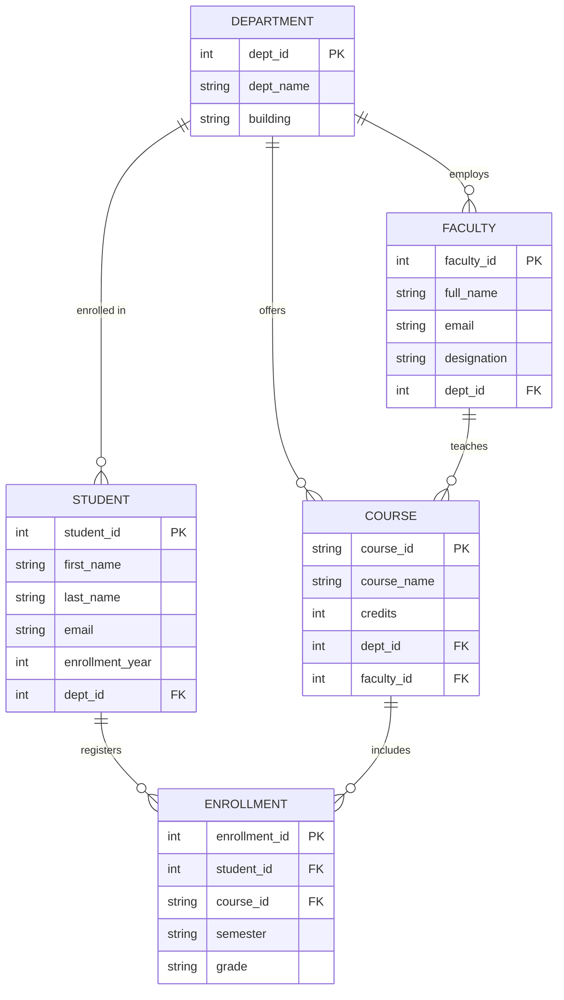
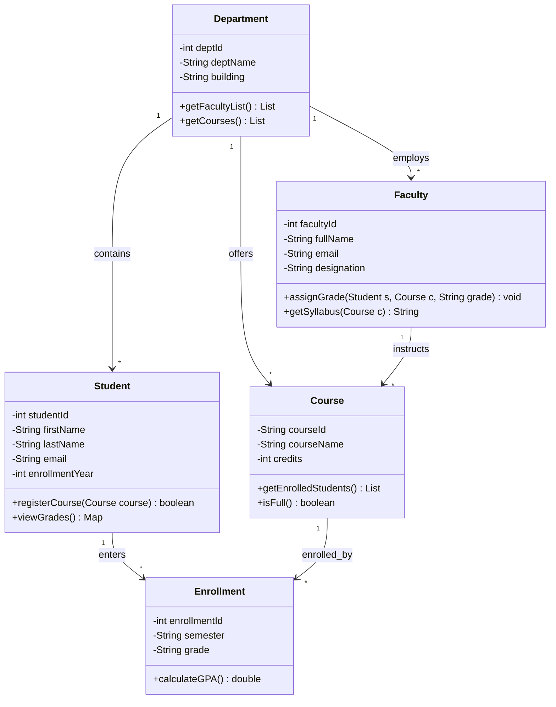

# Experiment 9: AI-Generated UML/ER/Architecture Diagrams

## Aim
To generate UML/ER diagram code from a textual description using an AI tool (GitHub Copilot / Windsurf / Claude / Ollama), and to render, inspect, and verify the diagram using the Mermaid Live Editor.

## Course Outcome(s) Mapped
- **CO4**: Apply modern software engineering tools, AI assistants, and automated documentation generators to streamline software maintenance, specification, and testing workflows.

## Tools / Software Required
- **AI Tool**: GitHub Copilot Chat / Windsurf / Claude / Ollama.
- **Rendering Platform**: [Mermaid Live Editor](https://mermaid.live/) (free, in-browser diagram visualizer and exporter).
- **Format**: Mermaid Markdown (`.mmd`).

---

## Pre-Lab Theory
Visual modeling is essential in software architecture and database design. 
1. **Diagrams as Code (DaC)**:
   Instead of using heavy, proprietary binary diagram tools (e.g., Microsoft Visio), modern engineering teams declare diagrams in lightweight text-based markup formats like **Mermaid**, **PlantUML**, or **Graphviz**. Textual diagrams can be version-controlled in Git, diffed, reviewed in pull requests, and generated by Large Language Models.
2. **Entity-Relationship (ER) Diagrams**:
   ER diagrams model the logical database structure by representing:
   - **Entities**: Real-world objects/tables (e.g., `STUDENT`, `COURSE`, `FACULTY`).
   - **Attributes**: Properties of entities (e.g., `student_id`, `credits`), designated as Primary Keys (`PK`) or Foreign Keys (`FK`).
   - **Relationships & Cardinalities**: Numerical relationships between entities:
     - Exactly one (`||--||`)
     - Zero or one (`|o--||`)
     - One or more (`||--|{`)
     - Zero or more (`||--o{`)
3. **Class Diagrams (UML)**:
   UML Class diagrams model the object-oriented structure of a software system, showing classes, attributes (state), methods/operations (behavior), visibility (`+` public, `-` private, `#` protected), and structural relationships (inheritance, association, composition).

---

## Natural Language System Description

> **College Management System Brief:**  
> "Design a database and system model for a college academic management system. The system consists of Departments, Students, Faculty, and Courses. Each Department has an ID, name, and building location. A Department employs multiple Faculty members and offers multiple Courses. Each Student belongs to one Department and can enroll in multiple Courses. Each Course has a course code, title, credit count, and is taught by one Faculty member. A Faculty member can teach zero or more courses. The registration of Students into Courses is tracked through an Enrollment entity that records the student, course, semester, and grade."

---

## AI Prompt Used
> **Prompt:**  
> "Generate a Mermaid ER diagram for a college system with entities Student, Course, Faculty, Department, and Enrollment. Include primary keys, foreign keys, non-key attributes, and accurate Crow's Foot cardinality notations. Also provide the corresponding UML Class diagram."

---

## Generated Mermaid ER Diagram (`college_er_diagram.mmd`)

---

## Generated UML Class Diagram (`college_class_diagram.mmd`)

---

## Sample Output (Step Executed + Result Shown)

### 1. Step-by-Step Execution in Mermaid Live Editor (`mermaid.live`)
1. Navigated to `https://mermaid.live/edit`.
2. Pasted the generated Mermaid ER diagram text into the left editor pane.
3. The live preview rendered immediately on the right with zero parsing errors.
4. Exported the rendered vector graphic (SVG / PNG) for the lab report records.

### 2. Entity & Attribute Verification Matrix

| Entity | Primary Key (PK) | Foreign Keys (FK) | Additional Attributes | Verification Status |
| :--- | :--- | :--- | :--- | :---: |
| **DEPARTMENT** | `dept_id` (int) | None | `dept_name`, `building` | Valid |
| **STUDENT** | `student_id` (int) | `dept_id` | `first_name`, `last_name`, `email`, `enrollment_year` | Valid |
| **FACULTY** | `faculty_id` (int) | `dept_id` | `full_name`, `email`, `designation` | Valid |
| **COURSE** | `course_id` (string) | `dept_id`, `faculty_id` | `course_name`, `credits` | Valid |
| **ENROLLMENT** | `enrollment_id` (int) | `student_id`, `course_id` | `semester`, `grade` | Valid (Resolves M:N) |

### 3. Cardinality Relationship Cross-Check

| Relationship | Mermaid Syntax | Cardinality Meaning | Validation |
| :--- | :--- | :--- | :---: |
| Department to Student | `DEPARTMENT \|\|--o{ STUDENT` | One department has zero or many students; each student belongs to exactly one department. | Accurate |
| Department to Faculty | `DEPARTMENT \|\|--o{ FACULTY` | One department employs zero or many faculty members. | Accurate |
| Department to Course | `DEPARTMENT \|\|--o{ COURSE` | One department offers zero or many courses. | Accurate |
| Faculty to Course | `FACULTY \|\|--o{ COURSE` | One faculty member teaches zero or many courses; each course has one instructor. | Accurate |
| Student to Enrollment | `STUDENT \|\|--o{ ENROLLMENT` | One student has zero or many course enrollments. | Accurate |
| Course to Enrollment | `COURSE \|\|--o{ ENROLLMENT` | One course has zero or many enrollments. | Accurate |

---

## Expected Output / Deliverable
1. Valid Mermaid markup files (`college_er_diagram.mmd` and `college_class_diagram.mmd`).
2. Visual diagram rendering confirming entities, attributes, primary/foreign keys, and cardinalities.

## Result
Thus the experiment was executed successfully using AI-assisted tools to translate unstructured textual specifications into standard Mermaid ER and UML diagrams, verified against logical schema constraints.

---

## Viva-Voce Questions & Detailed Answers

### 1. What is the purpose of an ER diagram versus a class diagram?
**Answer:**  
| Feature | Entity-Relationship (ER) Diagram | UML Class Diagram |
| :--- | :--- | :--- |
| **Primary Domain** | Relational Database Design & Storage Schema | Object-Oriented Software Design & Architecture |
| **Focus** | Data persistence, entities, attributes, primary/foreign keys | Object encapsulation: state (attributes) and behavior (methods) |
| **Relationships** | Cardinality (one-to-one, one-to-many, many-to-many) | Object relationships (Inheritance, Composition, Aggregation, Association) |
| **Operations / Logic**| Does **not** include functions, methods, or algorithms | Explicitly specifies public/private methods and signatures |
| **Standard** | Peter Chen notation / Crow's Foot notation | OMG (Object Management Group) Unified Modeling Language (UML) |

### 2. What is Mermaid and how does it relate to 'diagrams as code'?
**Answer:**  
Mermaid is a JavaScript-based diagramming and charting tool that uses simple, human-readable Markdown-like syntax to dynamically render flowcharts, sequence diagrams, state machines, Gantt charts, class diagrams, and ER diagrams.  
It embodies the **"Diagrams as Code" (DaC)** philosophy:
- **Version Control**: Diagrams reside inside Git repositories as plain text (`.mmd` or fenced markdown blocks), allowing side-by-side branch diffs in Pull Requests.
- **Maintainability**: Modifying a label or adding an entity takes seconds without needing to manually realign boxes and arrows.
- **AI Integration**: Text-based syntax enables LLMs to generate, refactor, and review system architectures directly in response to natural-language prompts.

### 3. How would you verify an AI-generated diagram is logically correct?
**Answer:**  
To verify an AI-generated diagram:
1. **Entity & Attribute Completeness Check**: Cross-check that every entity and essential attribute mentioned in the requirements prompt appears in the diagram.
2. **Key Integrity**: Ensure primary keys (`PK`) uniquely identify entities and foreign keys (`FK`) properly link child entities to parent tables.
3. **Cardinality Verification**: Inspect Crow's Foot symbols to verify business constraints (e.g., whether an entity can have zero instances or must have at least one; whether a relationship is 1:N or M:N).
4. **Resolution of Many-to-Many Relationships**: Check if direct M:N relationships between core entities (e.g., Student and Course) are properly decomposed using an associative junction entity (`Enrollment`) with appropriate composite or surrogate keys.
5. **Syntax Validation**: Render the code in a live parser (e.g., `mermaid.live`) to confirm there are no syntax errors or unescaped characters.

### 4. What cardinality notations are commonly used in ER diagrams?
**Answer:**  
In ER modeling, **Crow's Foot notation** and **Chen's notation** are standard. In Mermaid Crow's Foot syntax:
- `||--||` : Exactly one (mandatory one-to-one).
- `|o--||` : Zero or one to exactly one (optional one-to-one).
- `||--|{` : One or more (mandatory one-to-many).
- `||--o{` : Zero or more (optional one-to-many).
- `}o--o{` : Zero or more to zero or more (many-to-many).  
Each endpoint describes the minimum (0 or 1) and maximum (1 or many) occurrences of an entity participating in the relationship.
